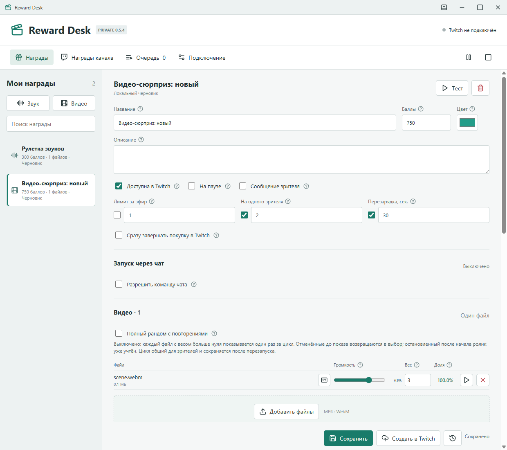
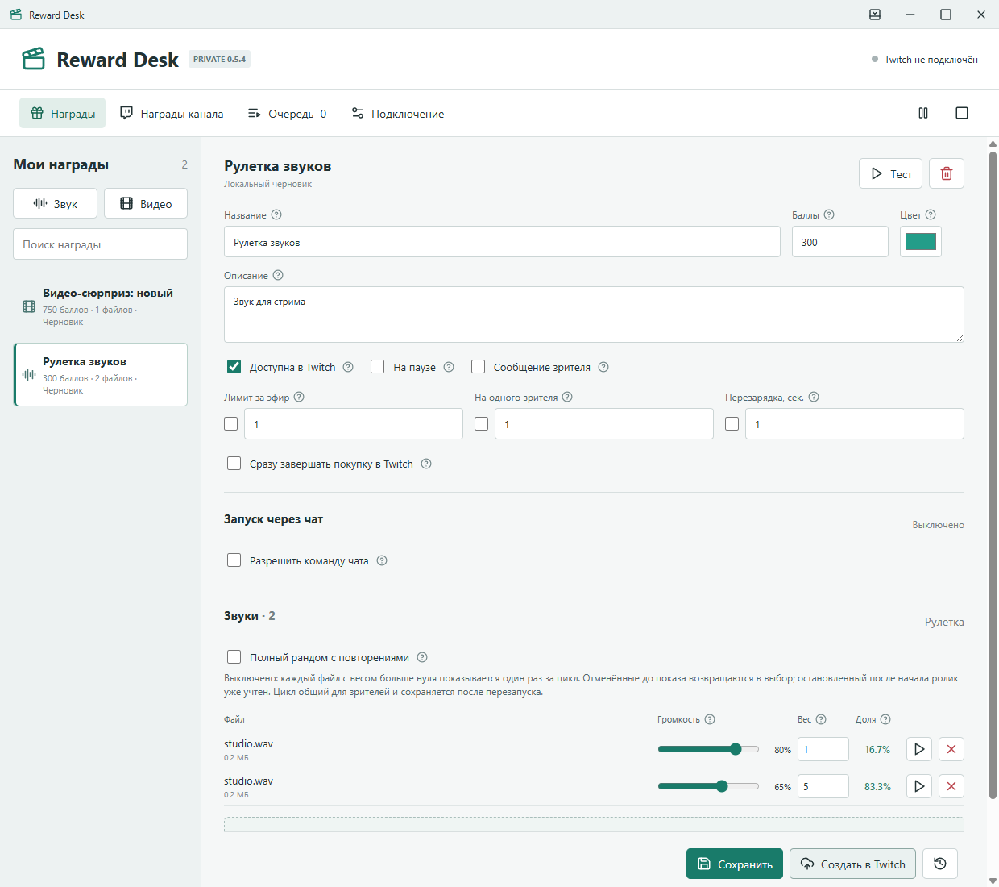
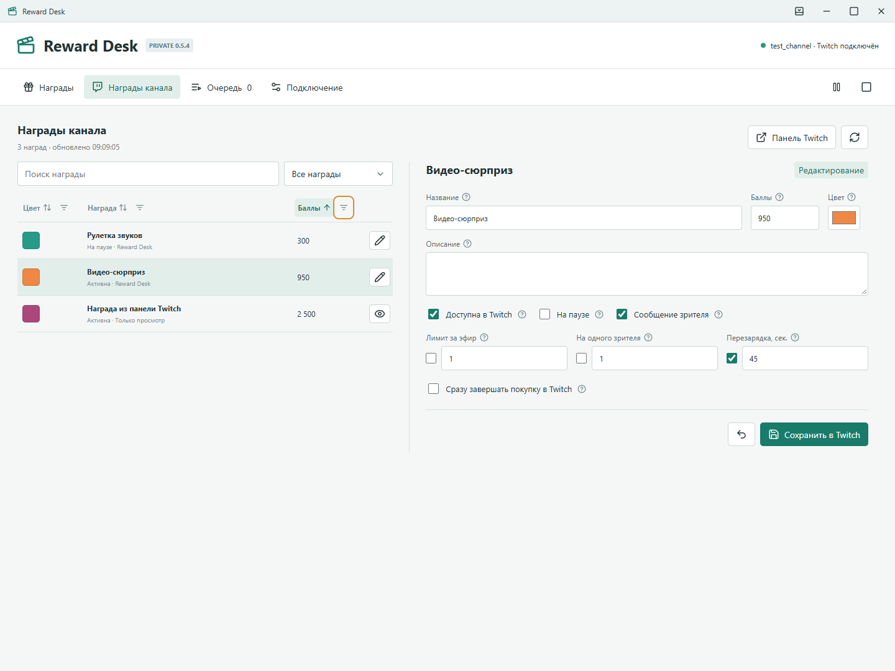
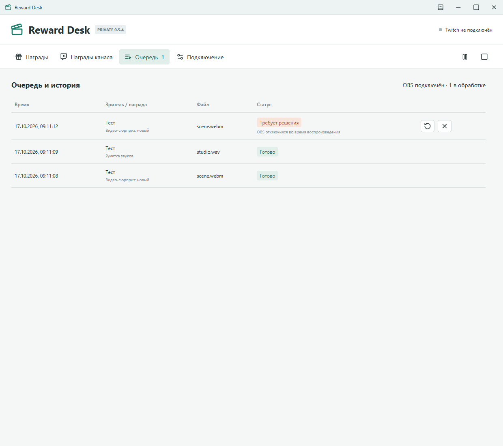

# Reward Desk

Приватная Windows-программа FermionaPlay для звуковых и видео-наград Twitch. Прямое подключение к Twitch, без Streamer.bot и без внешнего сервера воспроизведения.



## Возможности

- Создание, изменение, приостановка и удаление наград в Twitch.
- Вкладка «Награды канала»: список всех пользовательских наград с цветами, ценами, статусами, поиском, сортировкой и фильтрами по колонкам.
- Название, описание, цена в баллах, цвет, сообщение зрителя, лимиты за эфир и на зрителя, перезарядка и мгновенное завершение покупки.
- Один файл или рулетка из нескольких файлов. Целочисленный вес 0–10 000, доля веса или шанс выпадения в зависимости от режима, независимая громкость 0–100%.
- Циклическая рулетка без повторов по умолчанию, с сохранением прогресса. Опциональный полный рандом с повторениями; подсказки «?» у настроек.
- Бесплатный запуск награды командой чата только от разрешённых Twitch-ников, с отдельной паузой между командами и общей с покупками рулеткой.
- Аудио: MP3, WAV, OGG, M4A, FLAC. Видео: MP4 и WebM. Максимум 512 МБ на файл и 10 минут на воспроизведение. Совместимость зависит от кодека браузера OBS; рекомендуются H.264/AAC в MP4 или VP9/Opus в WebM.
- Видео в фиксированной области с перетаскиванием на превью 1920×1080 либо в случайной позиции. Максимальная ширина и высота, рамка, её цвет, толщина и стиль, скругление, случайный наклон от 0 до ±45°.
- Индивидуальная подпись для каждого ролика и полная длительность поверх видео: девять быстрых позиций, независимые X/Y, цвет, размер и шрифт подписи и длительности, общий предпросмотр с OBS.
- Тест отдельного файла и целой рулетки, общая пауза, остановка, очередь и история.
- Постоянная защищённая ссылка OBS. Одновременно воспроизводит только один подключённый экземпляр источника.
- SQLite, локальные копии медиа, резервная копия базы при старте. Токены шифруются через Windows DPAPI/Electron safeStorage.
- Автосохранение локального черновика, история 50 предыдущих сохранений и подготовленный установщик обновлений с полной резервной копией профиля.



## Установка

1. Получите `reward-desk-0.5.4-windows-x64-setup.exe` у владельца приватного репозитория или соберите из исходников.
2. Закройте уже запущенный Reward Desk через пункт «Выход» в трее. Установщик не завершает приложения принудительно.
3. Установите программу. Права администратора не нужны. Путь по умолчанию: `%LOCALAPPDATA%\Programs\Reward Desk`.
4. Запустите Reward Desk обычным ярлыком. Крестик полностью закрывает программу с сохранением черновика. Отдельная кнопка слева от сворачивания убирает окно в трей; обработка наград продолжается.
5. Для закрепления нажмите правой кнопкой на значок запущенного Reward Desk на панели задач → «Закрепить на панели задач». Установщик создаёт постоянные ярлыки меню «Пуск» и рабочего стола, но не закрепляет приложение без действия пользователя.

При перенаправлении профиля Windows/MSIX запуск блокируется до открытия обычным ярлыком: приложение не создаёт незаметно вторую базу. В `startup-diagnostics.jsonl` записываются версия, фактический путь базы и количество записей, без токенов Twitch или секретной ссылки OBS.

`profile-identity.json` связывает папку с её базой без хранения секретов. При пропаже, повреждении или подмене базы запуск останавливается; старая база не заменяется пустой. Сохраните всю папку профиля для диагностики, не удаляйте отдельные файлы защиты. Полное намеренное удаление профиля после выхода сбрасывает приложение, включая вход Twitch и ссылку OBS.

«Подключение → Восстановить локальные награды» принимает папку копии с `rewards.sqlite` и `media`. Добавляются только отсутствующие неопубликованные награды, их медиа, черновики, версии и завершённая история. Текущие награды, вход и ссылка OBS не заменяются, незавершённые задания не запускаются. Перед импортом создаётся копия базы, файлы сверяются по SHA-256. Конфликт или отсутствующий файл останавливает импорт.

Сборка не подписана сертификатом издателя: Windows может показать SmartScreen. Проверяйте источник файла и SHA-256 из того же приватного выпуска. Программа не отключает защиту Windows.

## Подключение Twitch

Для этой программы используется отдельная регистрация Twitch Developer Console, тип клиента **Public**, Client ID `tcpc4ec2vv6ggubzprbtqj050lcmbx`. Он встроен в сборку и не является секретом. Client Secret не требуется и не должен попадать в приложение.

1. Создайте приложение в [Twitch Developer Console](https://dev.twitch.tv/console/apps/create). Название: `Reward Desk by FermionaPlay`, тип: Public, категория: Application Integration, допустимый redirect для регистрации: `http://localhost`.
2. Скопируйте Client ID в «Подключение». При настроенной сборке он уже заполнен.
3. Нажмите «Войти через Twitch», подтвердите код в браузере, разрешите `channel:manage:redemptions` и `user:read:chat`. Право отправки сообщений не запрашивается.
4. Создайте локальную награду, добавьте медиа, сохраните, затем нажмите «Создать в Twitch».

Доступность баллов канала определяется Twitch. Программа управляет только своими привязанными наградами, не забирает чужие награды и не изменяет аукционы/автоотметки. Twitch API не поддерживает загрузку пользовательской иконки награды. Смена Client ID у уже созданных наград потребует исходной регистрации для управления ими.

## Награды канала

После входа вкладка «Награды канала» загружает все пользовательские награды, включая отключённые и созданные в панели Twitch или другими приложениями. Цвет показан образцом, рядом отображаются цена и статус. Доступны поиск, фильтр и ручное обновление.

Кнопка фильтра в заголовке колонки открывает выбор одного или нескольких цветов, поиск по названию и состоянию либо диапазон стоимости в баллах. Границы диапазона включаются в результат; все фильтры сочетаются с фильтром доступа. Общий сброс расположен рядом со счётчиком найденных наград. Клик по названию колонки переключает сортировку по возрастанию, убыванию и исходный порядок. Фильтры и сортировка работают локально и не меняют настройки Twitch.

**Twitch разрешает изменять награду через API только приложению с Client ID, использованным при её создании.** Для таких наград доступны название, описание, цена, цвет, доступность, пауза, запрос сообщения, лимиты и перезарядка. У остальных поля доступны только для просмотра; кнопка открывает панель канала Twitch. Стандартные встроенные награды Twitch не возвращаются Custom Rewards API и настраиваются в панели Twitch.

Перед сохранением приложение проверяет текущие права, аккаунт и настройки на Twitch. При обнаружении сторонних изменений запись блокируется до обновления списка. Меняются только отредактированные поля. Медиа, громкости, шансы, оформление видео и история не заменяются. Изменения синхронизированных наград подтягиваются в локальный редактор; неотправленные локальные изменения не перезаписываются.

В редакторе новой звуковой или видео-награды те же поля доступны до нажатия «Создать в Twitch».



## Рулетка и медиа

По умолчанию «Полный рандом с повторениями» выключен, в том числе у старых наград без этой настройки. Файлы с весом выше нуля выбираются случайно из ещё не выбранных в текущем цикле. После выбора всех начинается новый цикл; его первый файл не совпадёт с последним файлом прошлого цикла, если файлов больше одного. Цикл отдельный для каждой награды и аккаунта, общий для всех зрителей, не зависит от интервалов между покупками и сохраняется после перезапуска.

Вес в циклическом режиме определяет очередность среди оставшихся: каждый включённый файл всё равно выбирается ровно один раз за цикл. Колонка «Доля» показывает долю веса, а не фиксированную частоту показов. При включении полного рандома каждый выбор независимый, с прежними весами; колонка «Шанс» показывает вероятность, возможны повторы подряд. Вес 0 исключает файл из обоих режимов.

Тест всей награды участвует в её цикле. Тест отдельного файла цикл не меняет. Повтор прерванного задания воспроизводит уже выбранный файл; новое выпадение не выполняется. Файл в очереди резервируется, но расходует цикл только при начале воспроизведения. Отмена до старта возвращает его в выбор и согласует оставшуюся очередь без повторов. Остановка начатого ролика не обнуляет прогресс: он уже учтён. Файлы, уже показанные в текущем цикле, не возвращаются в остаток из-за изменения их веса. Текст и оформление ожидающих заданий берутся из снимка на момент добавления, а не из последующих правок награды.

Начиная с 0.5.4 источник OBS сверяет версию своих файлов при подключении и обновляется после будущих обновлений приложения. При переходе с более старой версии один раз обновите браузерный источник в OBS, чтобы загрузить эту проверку; ссылка источника остаётся прежней.

Максимальные размеры видео включают рамку. Предпросмотр и OBS сохраняют исходные пропорции и подгоняют рамку к самому кадру, без дополнительных пустых полей. Полосы, которые уже записаны в исходном видео, автоматически не обрезаются. Вопросики возле опций объясняют их назначение при наведении, фокусе клавиатуры или нажатии; Escape скрывает подсказку.

## Команды чата

В редакторе награды включите «Разрешить команду чата», укажите, например, `!video`, и логины зрителей через запятую, пробел или новую строку. Допускается `@` перед ником. Сохраните награду. Владелец канала и модераторы тоже должны быть явно указаны: пустой список не даёт доступ всем.

Команда сравнивается со всем сообщением без учёта регистра; аргументы и упоминание команды внутри другой фразы не подходят. Одинаковую включённую команду нельзя назначить двум наградам одного аккаунта. Учитываются только сообщения в своём канале, не пересланные из другого канала Shared Chat, и не сообщения покупки награды. Бот или Streamer.bot не нужен.

Запуск бесплатный и независим от стоимости, доступности, паузы и лимитов **покупки в Twitch**. Можно использовать локальную награду, не создавая её в Twitch. Для команды задаётся собственная общая пауза, по умолчанию 5 секунд; 0 отключает её. Общая пауза **воспроизведения** в приложении сохраняется: задания ждут в очереди. Команды и покупки используют один цикл рулетки и оформление медиа. В истории показываются команда и зритель; бесплатное задание не меняет статусы покупок Twitch.

При обновлении с 0.3.0 повторно нажмите «Войти через Twitch» в «Подключение», чтобы дать доступ к чтению чата. Выходить из аккаунта или пересоздавать награды не нужно. До этого обычные покупки продолжают работать, а команды показывают запрос новых прав. Reward Desk должен быть запущен: пропущенные во время его отключения сообщения чата не воспроизводятся задним числом.

## Текст на видео

В разделе «Текст на видео» выберите ролик и заполните «Текст ролика» или нажмите кнопку подписи рядом с нужным файлом. У каждого видео рулетки свой текст, а шрифт, цвет, размер и положение общие для этой награды. Предпросмотр переключается на выбранное видео. Пустое поле отключает подпись только этого ролика. Старый общий текст сохраняется у существующих файлов; новые добавляются с пустой подписью.

По умолчанию надпись жирная, внизу по центру поверх изображения. Сетка из девяти кнопок размещает её в углу, середине стороны или центре и обнуляет X/Y. Затем можно задать смещения в пикселях источника OBS: отрицательный X сдвигает влево, отрицательный Y поднимает. Доступны переносы строк. Текст ограничен кадром, длинные надписи переносятся и при необходимости уменьшаются; размеры видео при этом не меняются. В очереди сохраняется подпись на момент запуска, поэтому дальнейшие правки не меняют ожидающий показ.

«Показывать длительность видео» включает второй слой с полной длиной выбранного ролика, например `0:24`, а не обратным отсчётом. Значение берётся из метаданных текущего файла рулетки. У слоя свои шрифт, размер, цвет, девять позиций и X/Y. При исходной нижней центральной позиции, X=0, Y=−64 длительность располагается над подписью; можно задать другое положение. Оба слоя видны на превью и поворачиваются вместе с видео. Шрифты должны быть установлены на компьютере с OBS; иначе используется системная замена.

## OBS

В «Подключение» скопируйте URL и добавьте в OBS источник «Браузер» размером **1920×1080**. Фон прозрачный. Включите «Управлять аудио через OBS» для вывода звука в нужные дорожки. При необходимости настройте мониторинг в расширенных свойствах аудио OBS.

Не отключайте источник при его невидимости, если звук должен продолжаться при переключении сцен. Используйте один общий источник, добавленный в сцены как существующий. Если открыты несколько копий, проигрывание получает только первая готовая; остальные не дублируют звук. Кнопка «Предпросмотр» открывает такой же проигрыватель и тоже считается подключением.

Порт по умолчанию **18874**, только `127.0.0.1`. URL и ключ сохраняются между перезапусками/обновлениями. При занятом порте автоматического перехода на другой нет: приложение показывает ошибку. Изменение порта вручную требует обновления URL в OBS. Ссылка не даёт доступа к редактору, но позволяет получать медиасобытия; не публикуйте её.

## Очередь и возвраты

- EventSub получает покупки в реальном времени; REST-проверка подхватывает пропущенные незавершённые покупки.
- ID покупки записывается в базу, поэтому повторное событие не создаёт дубль.
- Файл выбирается один раз криптографическим генератором `crypto.randomInt`. При повторе прерванного события остаётся тот же файл, новая рулетка не запускается.
- Незавершённая покупка подтверждается после окончания проигрывания. При ошибке медиа или ручной остановке отправляется отмена с возвратом баллов.
- При обрыве OBS или перезапуске посреди проигрывания запись получает статус «Требует решения». Можно повторить тот же файл либо отменить/вернуть баллы. Автоматического повтора потенциально уже прозвучавшего файла нет.
- При недоступном Twitch решение о завершении/возврате хранится в базе и повторяется после восстановления связи.
- При отсутствии OBS покупки ждут в очереди. Reward Desk должен быть запущен; серверного воспроизведения и фоновой службы после выхода нет.
- Режим «Сразу завершать покупку в Twitch» отключает возможность возврата со стороны приложения. Пропущенные во время отключения приложения мгновенно завершённые покупки не восстанавливаются из очереди Twitch. По умолчанию этот режим выключен.
- Перед удалением награда приостанавливается; при незавершённых покупках удаление блокируется, чтобы Twitch не подтвердил их автоматически.



## Данные и резервные копии

**Неопубликованные награды находятся во вкладке «Награды», а не «Награды канала».** Создание на Twitch для хранения локальных файлов не требуется. Фильтр поиска может скрыть награду; очистите его перед проверкой списка.

Изменения редактора записываются в локальный черновик через 250 мс после ввода, а также перед переключением награды и выходом. Даже незавершённые поля сохраняются. При следующем открытии редактора черновик восстанавливается. Это не меняет действующие настройки воспроизведения и не отправляет запросов Twitch: для применения используйте «Сохранить».

Кнопка истории возле «Сохранить» открывает до 50 предыдущих сохранённых версий этой награды. Восстановление открывает выбранную версию как черновик, сохраняя текущую связь с Twitch. Заменённый черновик тоже остаётся в истории. Импортированные медиа при этом не удаляются.

Профиль находится в `%APPDATA%\RewardDesk`, независимо от места установки:

- `rewards.sqlite` и WAL: настройки, награды, история, очередь и постоянный ключ OBS.
- `media/`: импортированные копии файлов. Перенос оригиналов не ломает награды.
- `backups/`: снимки базы при запуске. Медиа в эти снимки не входят; для полной копии закройте приложение и скопируйте всю папку профиля.
- `auth.bin`, `auth-pending.bin`: зашифрованный вход Twitch. Он привязан к учётной записи Windows.

Обновление и удаление программы не удаляют профиль. На другом ПК потребуется заново войти в Twitch. В Git не отправляются личный профиль, токены, история или пользовательские медиа.

## Обновления

В «Подключение → Обновления» доступны ручная проверка GitHub и проверка при запуске. При наличии нового стабильного выпуска появляется окно с изменениями, кнопками «Позже» и «Обновить и перезапустить». После подтверждения приложение загружает EXE, проверяет размер и SHA-256, сохраняет черновик и закрывается. Отдельный помощник ждёт завершения процесса, создаёт полную копию профиля в `%LOCALAPPDATA%\RewardDeskBackups\updates`, сверяет копию, запускает установщик и проверяет неизменность файлов профиля перед повторным открытием приложения. При незавершённых наградах обновление откладывается. Процессы принудительно не завершаются.

**Репозиторий сейчас приватный.** Анонимная проверка не может прочитать его выпуски и честно показывает недоступность, а не «последняя версия». GitHub-токен не встраивается в клиент. Подготовлен механизм для будущих доступных стабильных выпусков в `foolka/reward-desk`; до появления такого канала устанавливайте приватные сборки вручную. Публичность репозитория автоматически не меняется. См. [GitHub Releases API](https://docs.github.com/en/rest/releases/releases#get-the-latest-release).

Пререлизы, повреждённые загрузки, несовпадающие имена файлов и URL другого репозитория не устанавливаются. Проверка SHA-256 не заменяет подпись издателя. Ошибка помощника оставляет журнал рядом с загрузкой в `%TEMP%\RewardDeskUpdates`, а резервная копия хранится отдельно. Автообновление не заменяет собственную резервную копию на другом диске.

## Разработка

Node.js 24.14+, Windows x64 для сборки приложения. Зависимости зафиксированы в `package-lock.json`.

```powershell
npm ci
npm test
npm start
```

`npm run test:ui` использует отдельный временный профиль, отключает Twitch, генерирует тестовые аудио/видео через FFmpeg и проверяет интерфейс в Electron и источник в Chrome. Требуются FFmpeg и Google Chrome. Реальные OBS, Twitch-награды и пользовательская база не затрагиваются. Проверяются ширины 760, 1040 и 1440, непустые видеокадры, звук, дубли источника и обрыв проигрывания.

`npm run test:channel-ui` проверяет новую вкладку на искусственных данных: чужие награды только для просмотра, фильтры, цвета, сохранение, ошибки, несохранённые изменения и смена аккаунта. С Twitch этот тест не соединяется.

`npm run test:chat-ui` проверяет настройки команды, список ников, повторное сохранение, адаптивность, подсказки и уведомление о новых правах. Unit-тесты дополнительно проверяют привязку к аккаунту, EventSub, доступ по логинам, общий цикл с покупками, дедупликацию и отсутствие возвратов у бесплатных заданий.

`npm run test:recovery-ui` проверяет локальную рулетку с семью файлами, выход без «Сохранить», восстановление после перезапуска, историю и окно обновления. Реальный профиль не используется. Unit-тесты обновлений используют синтетические ответы GitHub и не запускают установщик.

`npm run test:update-helper` на Windows компилирует тестовые EXE-заглушки и проверяет отдельный помощник после завершения родительского процесса: полную копию и сверку профиля, аргументы установки и повторный запуск заглушки. Настоящая установка, реестр установки и пользовательские данные не затрагиваются.

`npm run test:video-layout` проверяет широкие, вертикальные и квадратные видео в предпросмотре и OBS, пиксели по четырём внутренним краям рамки, подпись и длительность, отсутствие перекрытия их исходного положения, компактность строк и доступность подсказок. Использует собственный временный профиль и синтетические ролики; поддерживает путь к собранному EXE как аргумент.

```powershell
node tools/create-assets.cjs
npm run build
$env:ISCC_EXE = 'C:\Program Files (x86)\Inno Setup 6\ISCC.exe'
npm run installer
```

Установщик создаётся Inno Setup 6. EXE, контрольная сумма и папка приложения находятся в `release/`. Для автоматической установки нужен доступный стабильный выпуск с EXE и одноимённым `.sha256`, как описано выше.

## Проверка Twitch API

Официальные источники: [Custom Rewards API](https://dev.twitch.tv/docs/api/reference/#create-custom-rewards), [EventSub Redemptions](https://dev.twitch.tv/docs/eventsub/eventsub-subscription-types/#channelchannel_points_custom_reward_redemptionadd), [Device Code Flow](https://dev.twitch.tv/docs/authentication/getting-tokens-oauth/#device-code-grant-flow).

Команды используют [Channel Chat Message в EventSub](https://dev.twitch.tv/docs/eventsub/eventsub-subscription-types/#channelchatmessage) с пользовательским токеном и правом `user:read:chat`.

Локальные тесты покрывают восстановление OAuth, создание/удаление наград, потерянный ответ создания и возврата, дедупликацию, выбор с весами и безопасность источника. Живое подтверждение покупки требует авторизации владельца канала и отдельного тестового использования награды.
