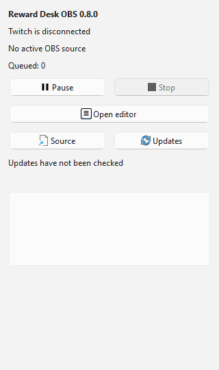
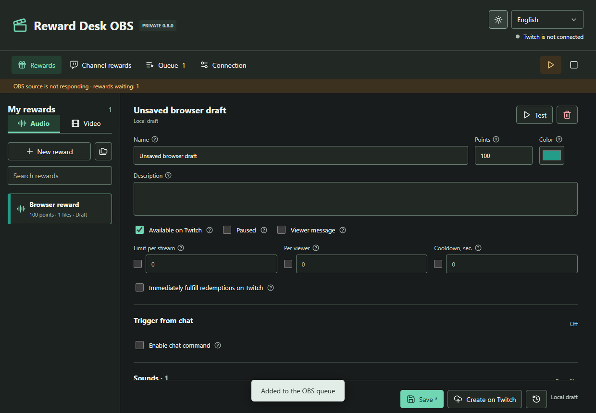

# Reward Desk OBS

Private Windows x64 preview. The OBS plugin and standalone app are alternative products, not two launchers for one database.





## Isolation

| | App | OBS plugin |
| --- | --- | --- |
| Profile | `%APPDATA%/RewardDesk` | `%APPDATA%/RewardDeskOBS` |
| Runtime | RewardDesk.exe | bundled RewardDeskOBS.exe |
| AppUserModelID | com.fermionaplay.rewarddesk | com.fermionaplay.rewarddeskobs |
| Source port | 18874 | 18875 |
| Release tag | vX.Y.Z | obs-vX.Y.Z |

The bundled runtime contains a mode marker, so launching its executable directly still selects the plugin profile. No live profile is copied, discovered, merged or overwritten. Credentials use Windows DPAPI. One instance per profile owns SQLite. Do not run both products for the same rewards/account at once.

The native Qt dock launches its own bundled runtime without a visible Electron window. It uses loopback HTTP with a per-process random capability from the plugin profile. Source capability is separate and remains stable across restarts. Dock permissions only cover status, pause, stop, reconnect, opening the editor and checking updates. The browser editor receives a different capability in the URL fragment, removes it from the address bar and has a single-writer lease. Arbitrary file paths, native lifecycle commands and recovery paths are not accepted by the HTTP API. Uploads are streamed with a 512 MiB limit into a unique temporary directory and imported through the existing media validator.

The runtime exits gracefully when its originating OBS process exits. An interrupted started job remains in attention state on next start; it is never replayed silently. Closing the editor tab does not stop playback. Existing source heartbeat/reconnect and optional source-only OBS recovery remain in place.

Profile recovery uses a native Windows folder picker and confirmation; HTTP requests cannot supply a recovery path. Opening the data folder only opens the fixed plugin profile. Recovery accepts missing unpublished local rewards, not a transfer of existing Twitch rewards or credentials. The private updater does not embed GitHub credentials. Install plugin updates using its separate installer after closing OBS; never use the app installer for the plugin.

## Build

Requires Node 24.14+, Visual Studio C++ Build Tools, CMake, the official OBS Qt 6.8 x64 SDK and Inno Setup. No Qt/OBS DLLs are copied into OBS itself.

```powershell
npm ci
$env:QT_SDK = 'C:\path\to\obs-qt6-sdk'
$env:ISCC_EXE = 'C:\path\to\ISCC.exe'
npm run build:obs
npm run package:obs
npm run installer:obs
```

Run `npm test` and `npm run test:obs`. UI tests create isolated profiles and never contact Twitch. With QT_SDK set they also render the real native dock in a separate preview process. The installer only supports normal OBS 32+ installations, uses ProgramData's plugin directory and refuses to install while OBS or RewardDeskOBS.exe is running. The standalone app can stay open.
